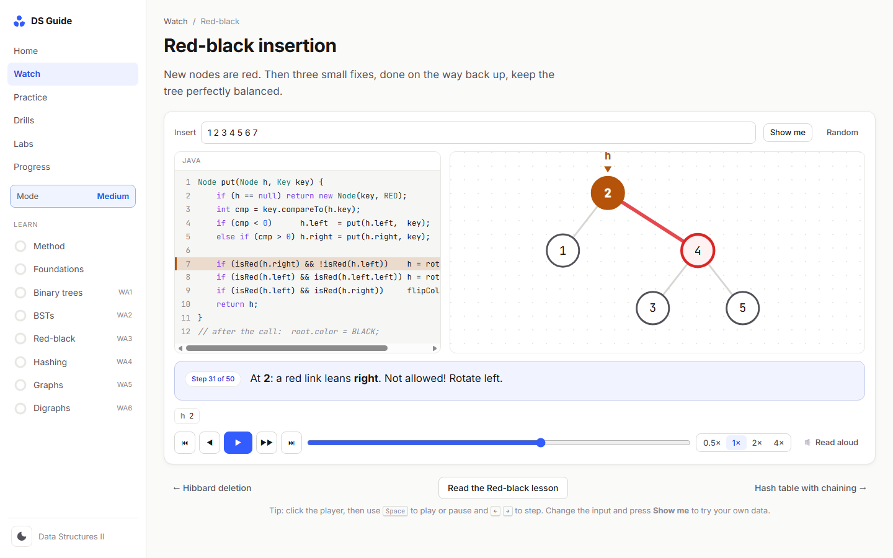
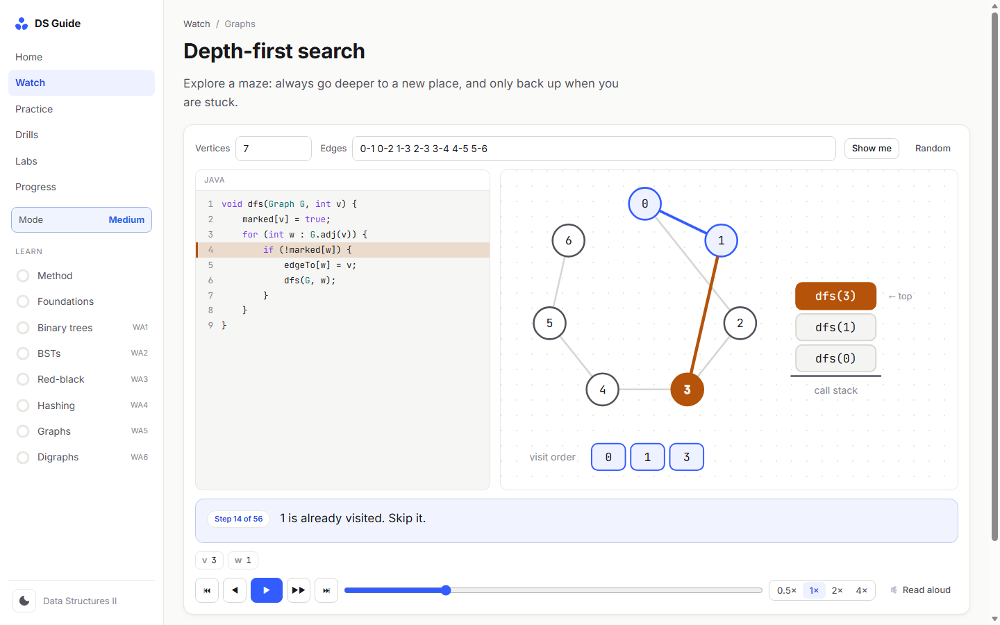
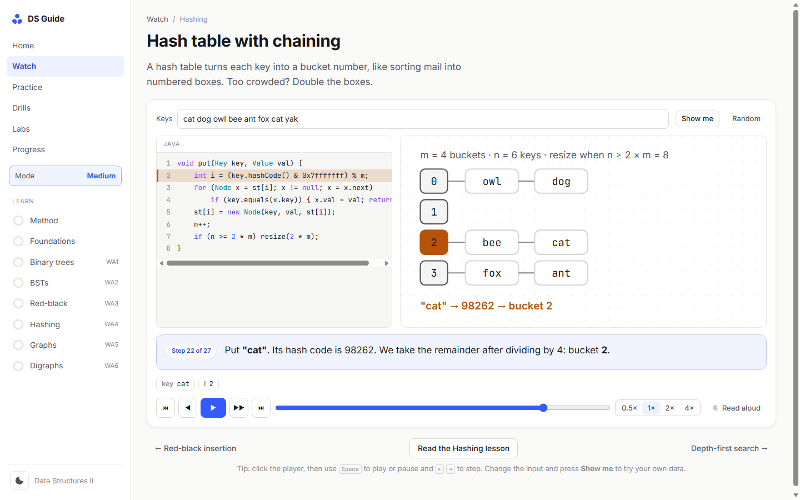
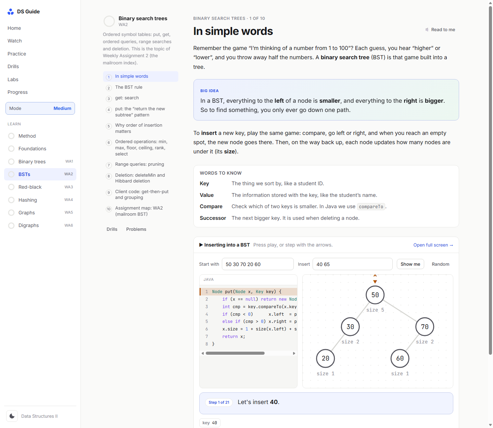
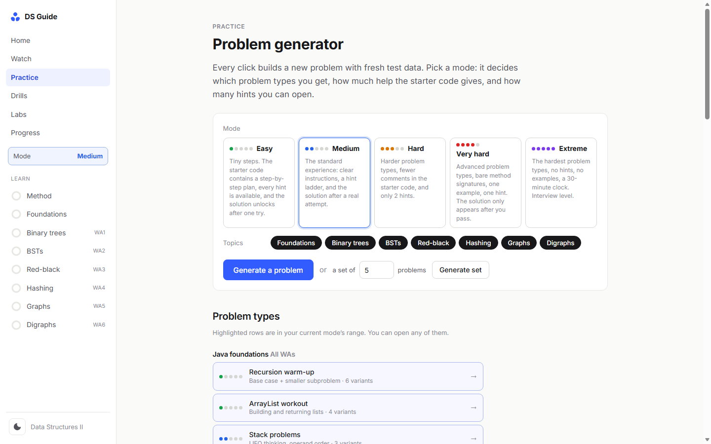
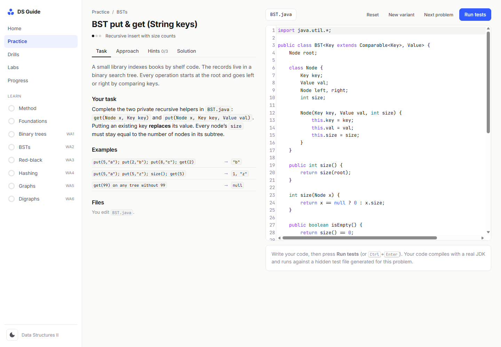
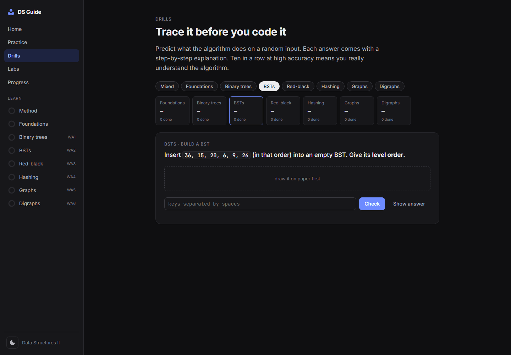

<div align="center">

# Data Structures Guide

**A self-hosted, interactive platform for learning data structures in Java, from "what is a variable?" to interview-level problems.**
Animated code walkthroughs, lessons in simple words, tracing drills, and an unlimited generator of auto-graded Java problems across five difficulty modes.




</div>

---

## Table of contents

- [Why this exists](#why-this-exists)
- [Features](#features)
- [Difficulty modes](#difficulty-modes)
- [Screenshots](#screenshots)
- [Quick start](#quick-start)
- [How it works](#how-it-works)
- [Security model](#security-model)
- [Curriculum](#curriculum)
- [Project structure](#project-structure)
- [Development](#development)
- [Changelog](#changelog)
- [Academic integrity](#academic-integrity)

## Why this exists

Most people get stuck on data structures for one of two reasons: they can't *see* what the code is doing, or they never get enough practice. This project fixes both:

1. **Watch.** Every core algorithm is animated. The line of Java being run lights up, the tree, stack, table or graph moves on screen, and one short sentence explains what just happened.
2. **Learn.** Each topic opens with an *In simple words* section, written at a 6th-grade reading level, before going deeper.
3. **Trace.** Randomized drills ask you to predict what an algorithm will do, then show the worked answer.
4. **Code.** Every click generates a fresh Java problem. Your code is compiled with a real JDK and checked by a hidden test suite.

## Features

| | |
|---|---|
| **Animated walkthroughs** | 12 step-by-step animations with code highlighting, plain-words narration, live variables, play/step/scrub/speed controls, keyboard shortcuts and **read-aloud**. Nodes really move: rotations slide, successors travel, keys fly to new buckets on resize. |
| **Teaching for everyone** | "In simple words" sections built on everyday comparisons (guessing games, mailboxes, nesting dolls), "Big idea" boxes, "Words to know" lists, hover glossary tooltips, and a "Read to me" button on every lesson. |
| **Five difficulty modes** | Easy → Medium → Hard → Very hard → Extreme. The mode controls problem levels, starter-code scaffolding, hint limits, examples, solution unlocking and an interview clock. |
| **Problem generator** | 38 problem types and **112 variants**, from recursion warm-ups to red-black deletion and strongly connected components. Every problem has fresh random test data. |
| **Real compilation** | Code is compiled with `javac` and run in a sandbox with per-test timeouts. You see expected vs. actual values, crash lines, infinite-loop detection and your own `System.out` output. |
| **Tracing drills** | 15 randomized drill types whose input size follows your mode, each with a step-by-step explanation. |
| **Interactive labs** | BST, red-black (with the matching 2-3 tree), hash table, graph search and expression-parsing sandboxes. |
| **Mastery tracking** | Per-topic mastery (reading 20%, drills 30%, coding 50%). A problem type is mastered after two clean solves of different variants. Includes a streak counter and progress export/import. |
| **Protected answers** | Hidden tests and reference solutions never reach the browser (see [Security model](#security-model)). |
| **Polished UI** | Minimal design, light and dark themes, responsive layout, `prefers-reduced-motion` support, zero dependencies, no build step. |

## Difficulty modes

| Mode | Problem levels | Starter code | Hints | Examples | Solution unlocks |
|---|---|---|---|---|---|
| 🟢 **Easy** | 1 | Step-by-step plan written into the code | All | All | After 1 run |
| 🔵 **Medium** | 1–2 | Normal | All | All | After a real attempt |
| 🟠 **Hard** | 2–3 | Lean comments | 2 | All | After 4 runs |
| 🔴 **Very hard** | 3–4 | Bare signatures | 1 | 1 | Only after passing |
| 🟣 **Extreme** | 4–5 | Bare signatures | 0 | 0 | Only after passing · 30-min clock |

All of these rules are enforced by the server, not the browser.

## Screenshots

<table>
  <tr>
    <td width="50%"><p align="center"><sub>Depth-first search with the call stack and visit order</sub></p></td>
    <td width="50%"><p align="center"><sub>Hash table with chaining, mid-insert</sub></p></td>
  </tr>
  <tr>
    <td width="50%"><p align="center"><sub>"In simple words" lesson with an embedded animation</sub></p></td>
    <td width="50%"><p align="center"><sub>Problem generator with five difficulty modes</sub></p></td>
  </tr>
  <tr>
    <td width="50%"><p align="center"><sub>Problem workspace with a real Java editor</sub></p></td>
    <td width="50%"><p align="center"><sub>Tracing drills (dark mode)</sub></p></td>
  </tr>
</table>

## Quick start

**Requirements**

- [Node.js](https://nodejs.org/) 18 or newer
- A JDK (11+). It is auto-detected from `JAVA_HOME`, your `PATH`, common install locations, and the JDK bundled with IntelliJ IDEA.

```bash
git clone https://github.com/Kuzma12/DataStructuresGuide.git
cd DataStructuresGuide
npm start
```

On Windows, double-click **`start.bat`**. The site opens at **http://localhost:4317**. Lessons, animations, labs and drills work without a JDK; only code checking needs one.

## How it works

```
Browser (vanilla ES modules)                           Local Node server (zero dependencies)
┌───────────────────────────────────┐  GET /api/problem ┌───────────────────────────────────────┐
│ lessons · animations · drills     │ ────────────────▶ │ template + seed + mode                │
│ catalog (public metadata only)    │ ◀──────────────── │  → story, task, scaffolded starter    │
│ CodeMirror editor                 │  POST /api/run    │ harness rebuilt server-side           │
│ results, mastery, progress        │ ────────────────▶ │ javac -g → java Main (3 s per test)   │
│                                   │ ◀──────────────── │ PASS / FAIL / ERROR + unlock status   │
│                                   │  POST /api/hint   │ hint / solution released only if the  │
│                                   │  POST /api/solution│ mode's rules are met (data/progress) │
└───────────────────────────────────┘                   └───────────────────────────────────────┘
```

- **Deterministic generation.** A seeded PRNG rebuilds the same problem from `(templateId, seed)`, so every problem has a stable URL.
- **Test harness.** Each problem generates a `Main.java` that extends a small `TestKit`. It compares your results against a reference implementation over random inputs and reports readable diffs.
- **Animation engine.** Algorithms record frames (`{line, say, scene, vars}`). A keyed SVG renderer tweens shapes between frames, so the same node visibly moves instead of being redrawn.

## Security model

| Concern | Protection |
|---|---|
| Reading hidden tests or solutions in DevTools | Generators, harnesses and solutions live in `server/problems/` and are never served. Public payloads are checked for leaks by the smoke test in every mode. |
| Tampering with tests | `/api/run` takes only your code. The server rebuilds the harness itself. |
| Unlocking help early | Hints and solutions are released by the server according to the mode and the server-side progress record. |
| Browsing server files | Allow-list of file types under `public/` only. Dotfiles and `package.json` are blocked, and path traversal returns 404. |
| Malicious websites calling the local server | Host-header validation (DNS rebinding), rejection of cross-origin POSTs, and binding to `127.0.0.1` only. |
| Injected content | A strict Content-Security-Policy plus `X-Frame-Options`, `nosniff`, `Referrer-Policy` and COOP. |
| Runaway code | One compile at a time, per-test thread timeouts, process timeouts, output caps, and a temp directory deleted after every run. |

## Curriculum

| # | Topic | Key skills | Animation |
|---|---|---|---|
| 0 | How to approach problems | 6-step method, recursion "leap of faith", reading failing tests | – |
| 1 | Java foundations | references and null, generics/`compareTo`, `ArrayList`, recursion, stacks/queues, parsing | Recursion · Postfix stack |
| 2 | Binary trees | tree recursion, traversals, expression trees | Traversals · Level order |
| 3 | Binary search trees | put/get with sizes, ordered ops, ranges, Hibbard deletion | Search · Insert · Delete |
| 4 | Red-black BSTs | 2-3 trees, rotations, color flips, balanced insertion | Red-black insertion |
| 5 | Hash tables | `hashCode`, modular hashing, chaining, probing, resizing | Hash table with chaining |
| 6 | Undirected graphs | adjacency matrix and lists, DFS, BFS, paths, components | DFS · BFS |
| 7 | Digraphs | symbol graphs, DFS orders, cycles, topological sort, SCCs | Topological sort |

## Project structure

```
DataStructuresGuide/
├── server/
│   ├── server.js          # static allow-list, security headers, JSON API
│   ├── java.js            # JDK discovery, compile/run sandbox, output parsing
│   ├── progress.js        # server-side runs / passes / hints / peeks (gates help)
│   └── problems/          # 🔒 never served: generators, harnesses, solutions, modes
│       ├── service.js     #    modes, scaffolding, hint and solution gating
│       ├── kit.js         #    TestKit + harness helpers
│       └── *.js           #    problem templates per topic (+ advanced.js, levels 4–5)
├── public/
│   ├── index.html
│   ├── css/style.css
│   └── js/
│       ├── anim/          # stage (tweened SVG), scenes, player, 12 walkthroughs
│       ├── views/         # home, watch, learn, practice, problem, drills, labs, progress
│       ├── lessons/       # lesson content + "In simple words" + glossary
│       ├── catalog.js     # public problem metadata + modes (fetched from the server)
│       ├── drills.js · labs.js · ds.js · viz.js · store.js · editor.js
├── tools/
│   ├── verify.js          # every variant: the reference passes, the starter compiles
│   ├── verify-modes.mjs   # every scaffolded starter compiles (Easy / Hard / Very hard)
│   ├── smoke.mjs          # drills at 5 levels, all walkthrough frames, leak checks
│   └── scenarios.mjs      # learner-mistake feedback through the live API
├── docs/screenshots/
├── CHANGELOG.md
└── start.bat
```

## Development

```bash
npm run verify                  # reference solutions pass, starters compile (all variants)
node tools/verify-modes.mjs     # scaffolded starters compile in every scaffold style
node tools/smoke.mjs            # thousands of generated drills, frames and payload leak checks
```

**Adding a problem type:** add a template to `server/problems/<topic>.js` exporting `id`, `topic`, `level` (1–5), `variants` and `generate(rng, seed, variant)`, then run the verifiers.

**Adding an animation:** add a walkthrough to `public/js/anim/walkthroughs.js` with `code`, `inputs` and `build(inputs)`. `build` returns frames `{ line, say, scene, vars }`, built from the scene helpers in `scenes.js`.

## Changelog

See [CHANGELOG.md](CHANGELOG.md). **v2.0.0** adds animations, five difficulty modes, 8 advanced problem types, simple-words teaching, and server-side protection of hidden files.

## Academic integrity

The practice problems are intentionally *different* from graded course assignments. They train the same underlying skills, so learners can complete their own coursework independently. This project contains no solutions to any course assignment.

---

<div align="center"><sub>Built with plain JavaScript, Node.js and Java · no frameworks, no dependencies</sub></div>
