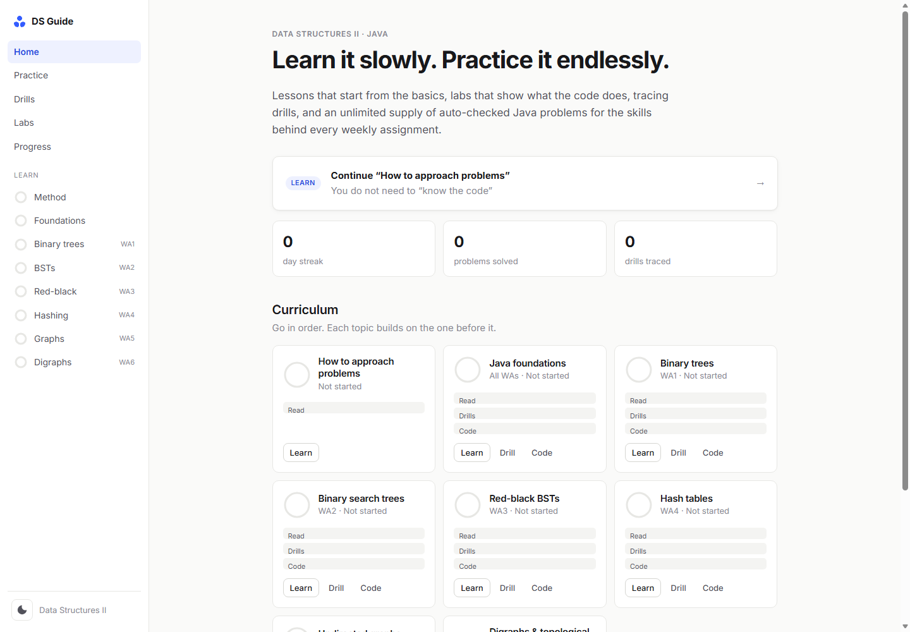
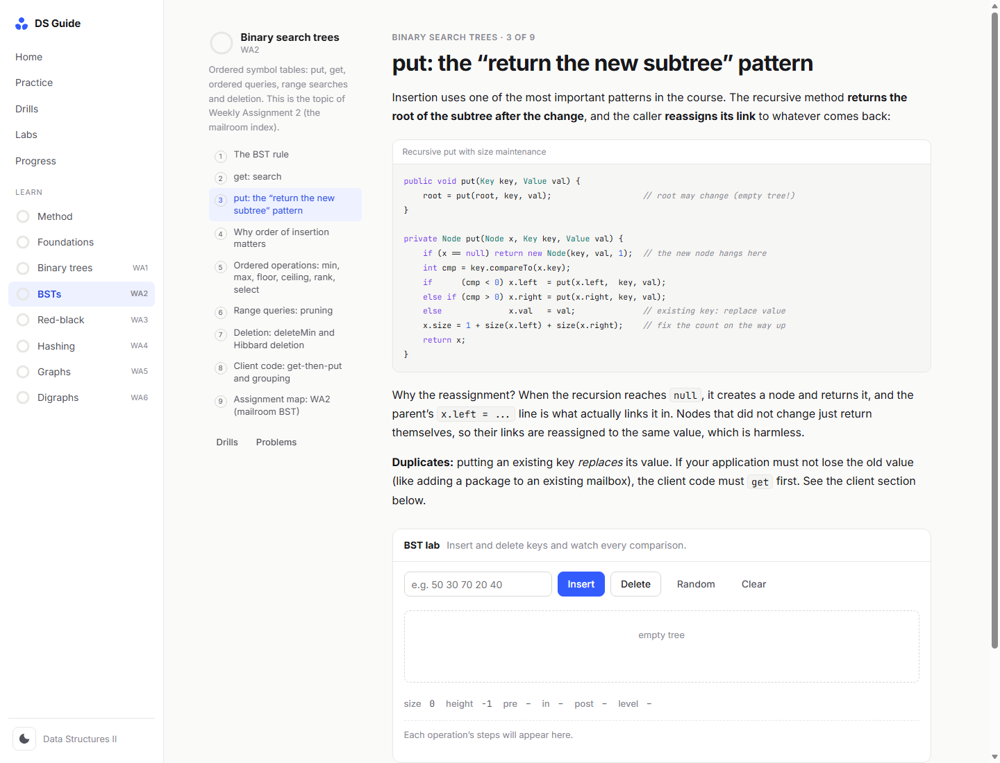
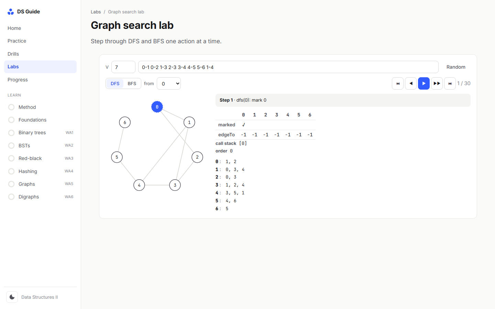

<div align="center">

# Data Structures Guide

**An interactive, self-hosted study platform for Data Structures II in Java.**
Lessons that start from the basics, visual labs, randomized tracing drills, and an unlimited generator of auto-graded Java coding problems.




</div>

---

## Table of contents

- [Overview](#overview)
- [Features](#features)
- [Screenshots](#screenshots)
- [Quick start](#quick-start)
- [How it works](#how-it-works)
- [Curriculum](#curriculum)
- [Project structure](#project-structure)
- [Development](#development)
- [Academic integrity](#academic-integrity)

## Overview

Data Structures Guide turns a data structures course into a guided path: **learn → visualize → trace → code → master**.

Every coding problem is generated from a template with a random seed, so you get a new variant with fresh test data each time. Your Java code is compiled by a real JDK and run against a hidden test harness on your own machine. The feedback shows what matters for learning: expected vs. actual values, the exact line of a crash, infinite-loop detection, and your own `System.out` output.

It runs entirely locally. There are no accounts, no cloud, no build step, and no npm packages.

## Features

| | |
|---|---|
| **Structured lessons** | 8 topics and 60 bite-sized sections with highlighted Java, inline diagrams and check questions. It starts with *how to approach a problem* before any data structure. |
| **Interactive labs** | BST insert/delete with step logs, red-black insertion next to the equivalent 2-3 tree, separate-chaining hash table with resizing, step-through DFS/BFS/DFS orders, and an expression parser. |
| **Tracing drills** | 15 randomized drill types (traversals, Hibbard deletion, LLRB insertion, hash indices, DFS/BFS order, topological sort…), each with a worked step-by-step explanation. |
| **Problem generator** | 30 problem types and 97 variants. Each one ships a starter file, a hidden test harness, a hint ladder, an approach guide and a reference solution. You can generate a single problem or a whole practice set. |
| **Real compilation** | Code is compiled with `javac` and run in a throwaway sandbox with per-test timeouts. Compile errors link to the offending line in the editor. |
| **Mastery tracking** | Per-topic mastery (reading 20%, drills 30%, coding 50%). A problem type is mastered after two clean solves of different variants. Includes adaptive difficulty, a streak counter, and progress export/import. |
| **Learning-first design** | Hints unlock one at a time. Solutions unlock only after genuine attempts. Recursion problems flag loops. |
| **Polished UI** | Minimal design, light and dark themes, responsive layout, keyboard shortcuts (<kbd>Ctrl</kbd>+<kbd>Enter</kbd> runs tests). |

## Screenshots

<table>
  <tr>
    <td width="50%"><p align="center"><sub>Problem workspace: task, hints and a real Java editor</sub></p></td>
    <td width="50%"><p align="center"><sub>Lessons with highlighted code and embedded labs</sub></p></td>
  </tr>
  <tr>
    <td width="50%"><p align="center"><sub>Step-through DFS / BFS with marked[], edgeTo[] and the call stack</sub></p></td>
    <td width="50%"><p align="center"><sub>Randomized tracing drills (dark mode)</sub></p></td>
  </tr>
</table>

## Quick start

**Requirements**

- [Node.js](https://nodejs.org/) 18 or newer
- A JDK (11+). The server auto-detects `JAVA_HOME`, your `PATH`, common install locations, and the JDK bundled with IntelliJ IDEA.

**Run**

```bash
git clone https://github.com/<your-username>/DataStructuresGuide.git
cd DataStructuresGuide
npm start
```

On Windows you can also double-click **`start.bat`**. The site opens at **http://localhost:4317**.

> The JDK status appears on the **Progress** page. Lessons, labs and drills work even without a JDK; only code checking needs it.

## How it works

```
Browser (vanilla ES modules)                     Local Node server (no dependencies)
┌─────────────────────────────┐   POST /api/run  ┌──────────────────────────────────┐
│ template + seed             │ ───────────────▶ │ temp dir per run                 │
│  → starter, hidden harness, │   your code +    │ javac -g  →  java Main results   │
│    hints, solution          │   harness files  │ per-test thread with 3 s timeout │
│ CodeMirror editor           │ ◀─────────────── │ parsed PASS / FAIL / ERROR       │
│ results, mastery, progress  │   JSON results   │ directory removed afterwards     │
└─────────────────────────────┘                  └──────────────────────────────────┘
```

- **Deterministic generation.** A seeded PRNG rebuilds the same problem from `(templateId, seed)`, so every problem has a stable URL.
- **Test harness.** Each problem generates a `Main.java` that extends a small `TestKit`. It compares your results against a reference implementation over random inputs and reports human-readable diffs.
- **Sandboxing.** Runs use a unique temp directory, validated file names, size limits, a serialized queue and hard timeouts. The server listens on `127.0.0.1` only.

## Curriculum

| # | Topic | Key skills | Example problem types |
|---|---|---|---|
| 0 | How to approach problems | 6-step method, recursion "leap of faith", reading failing tests | – |
| 1 | Java foundations | references and null, generics/`compareTo`, `ArrayList`, recursion, stacks/queues, parsing | recursion, stack evaluation, text parsing |
| 2 | Binary trees | tree recursion, pre/in/post/level order, expression trees | metrics, traversals, expression trees |
| 3 | Binary search trees | put/get with sizes, floor/ceiling/rank/select, range queries, Hibbard deletion | put & get, ordered ops, deletion, client code |
| 4 | Red-black BSTs | 2-3 trees, rotations, color flips, balanced insertion | rotations, LLRB put, invariant checks |
| 5 | Hash tables | `hashCode`, modular hashing, separate chaining, resizing | hash functions, chains, resizing table |
| 6 | Undirected graphs | adjacency matrix vs. lists, DFS, BFS, paths, components | representations, DFS/BFS, applications |
| 7 | Digraphs | symbol graphs, DFS orders, cycle detection, topological sort | DFS orders, topo sort, symbol digraphs |

## Project structure

```
DataStructuresGuide/
├── server/
│   ├── server.js        # static file server + JSON API (health, run)
│   └── java.js          # JDK discovery, compile/run sandbox, output parsing
├── public/
│   ├── index.html
│   ├── css/style.css    # design tokens, light/dark themes, responsive layout
│   └── js/
│       ├── main.js      # app shell + hash router
│       ├── views/       # home, learn, practice, problem, drills, labs, progress
│       ├── lessons/     # lesson content, one module per topic
│       ├── problems/    # problem templates (starter, harness, hints, solution)
│       ├── drills.js    # randomized tracing drills
│       ├── labs.js      # interactive labs
│       ├── ds.js        # JS data structures used by labs, drills and diagrams
│       ├── viz.js       # SVG renderers (trees, 2-3 trees, graphs, hash chains)
│       └── store.js     # progress, drafts and mastery (localStorage)
├── tools/
│   ├── verify.js        # compiles every variant: solutions pass, starters compile
│   ├── smoke.mjs        # imports every module and generates thousands of items
│   └── scenarios.mjs    # sends common learner mistakes through the live API
├── docs/screenshots/
├── start.bat
└── package.json
```

## Development

```bash
npm run verify             # every problem variant: reference passes all tests, starter compiles
node tools/smoke.mjs       # module imports + 3,000 generated drills + all problem variants
node tools/scenarios.mjs   # compile error / crash / timeout / wrong-answer feedback (server must be running)
```

**Adding a problem type:** add a template to `public/js/problems/<topic>.js` that exports `id`, `topic`, `level`, `variants` and `generate(rng, seed, variant)`. Return the starter file, harness body, hints, approach and solution, then run `npm run verify`.

## Academic integrity

The practice problems are intentionally *different* from graded course assignments. They train the same underlying skills, so learners can then complete their own coursework independently. This project does not contain solutions to any course assignment.

---

<div align="center"><sub>Built with plain JavaScript, Node.js and Java · no frameworks, no dependencies</sub></div>
